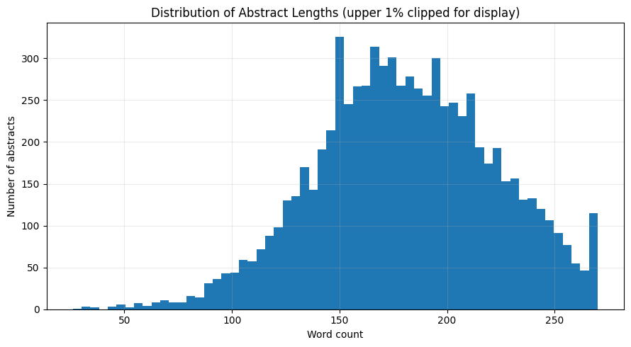

# arXiv AI/ML Research Abstracts: NLP Analysis

Exploratory text analysis of **7,701 arXiv AI/ML paper abstracts** (27 Sep 2025 – 29 Apr 2026) with scikit-learn: cleaning, keyword and TF-IDF analysis, LDA topic modelling and TF-IDF similarity search. Optional sentence-embedding and BERTopic extensions are included but switched off.

**Notebook:** [`notebooks/arxiv_ai_ml_abstracts_nlp_analysis.ipynb`](notebooks/arxiv_ai_ml_abstracts_nlp_analysis.ipynb) (outputs saved, renders on GitHub)

## Dataset

| | |
|---|---|
| Source | [arXiv AI/ML Research Papers 2025-2026](https://www.kaggle.com/datasets/shree0910/arxiv-aiml-research-papers-20252026) on Kaggle (`arxiv_ai_ml_papers.csv`) |
| Size | 7,701 rows × 26 columns, no duplicates, no missing abstracts |
| Period | 27 Sep 2025 – 29 Apr 2026 (a time-bounded sample, not all of arXiv) |
| Largest primary categories | cs.CV 18.4%, cs.LG 18.1%, cs.CL 14.5%, cs.RO 8.2%, cs.AI 7.2% |
| Abstract length | mean 180.8, median 180 words |

The CSV is not redistributed here; download it from Kaggle (see [Reproduce](#reproduce)).

## Method

1. Load and audit the data (types, missingness, duplicates), auto-detect title / abstract / year columns
2. Clean abstracts; compute length statistics
3. Term and bigram frequencies (`CountVectorizer`) with extra domain stop words
4. TF-IDF: mean-weighted distinctive terms and per-abstract top terms
5. LDA topic model (6 topics, `random_state=42`) with representative abstracts per topic
6. Phrase-mention shares by year
7. TF-IDF cosine-similarity search over abstracts
8. Export of cleaned data and result tables to CSV
9. *Not run:* `sentence-transformers` embeddings with k-means, and BERTopic

## Results

### Most frequent terms
`models` (6,939), `model` (5,634), `framework` (4,559), `data` (4,365), `learning` (3,831), `performance` (3,701), `training` (2,839), `reasoning` (2,708).


### LDA topics (dominant topic per abstract)

Topic labels below are my reading of the top terms, not model output; the notebook prints representative abstracts per topic for checking.

| Topic | Share | Top terms | Reading |
|---|---|---|---|
| 3 | 27.3% | learning, neural, networks, training, accuracy | Core deep learning and neural networks |
| 4 | 20.5% | visual, image, semantic, datasets, experiments | Vision and multimodal |
| 2 | 19.0% | reasoning, language models, LLMs, retrieval, generation | LLMs, reasoning and retrieval |
| 5 | 13.1% | optimization, control, policy, robot, efficiency | Optimisation, control and robotics |
| 0 | 10.1% | agents, user, systems, memory, human | Agents and human-AI systems |
| 1 | 10.0% | evaluation, detection, clinical, safety, dataset | Evaluation, safety and applied/clinical |


### Abstract lengths



## Limitations

- **No trend claims.** The "2025" group has only 416 records against 7,285 for "2026" because of the collection window. The notebook's year-share table (e.g. "large language model" 13.5% vs 26.7%) compares a late-2025 slice with a mostly-2026 sample and does not show topic growth. See `reports/figures/phrase_trends.png` for the chart this caveat applies to.
- Keyword mentions do not prove a topic is a paper's main contribution.
- LDA on bag-of-words with generic words such as "model" and "framework" gives overlapping topics. Treat them as a first pass; the embedding and BERTopic sections are the intended next step.
- Results describe this sample only, not arXiv as a whole.

## Reproduce

```bash
git clone https://github.com/Zain62543/Analyze-Research-Paper-Abstracts-Using-Data-Science-and-NLP.git
cd Analyze-Research-Paper-Abstracts-Using-Data-Science-and-NLP
python -m venv .venv && source .venv/bin/activate
pip install -r requirements.txt
# download arxiv_ai_ml_papers.csv from Kaggle into notebooks/ (or set FILE_PATH in the first code cell)
jupyter lab notebooks/arxiv_ai_ml_abstracts_nlp_analysis.ipynb
```

For the optional sections, install `sentence-transformers` (and `bertopic`) and set `RUN_EMBEDDINGS = True` / `RUN_BERTOPIC = True`.

## Author

Zain Ud Din · [LinkedIn](https://www.linkedin.com/in/zain-ud-din) · marwatzain8@gmail.com
