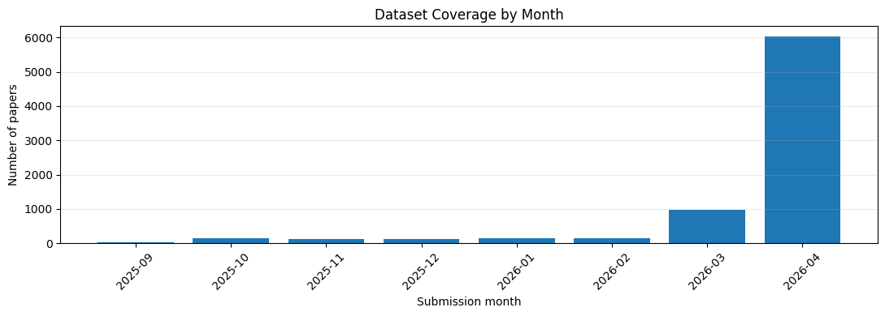
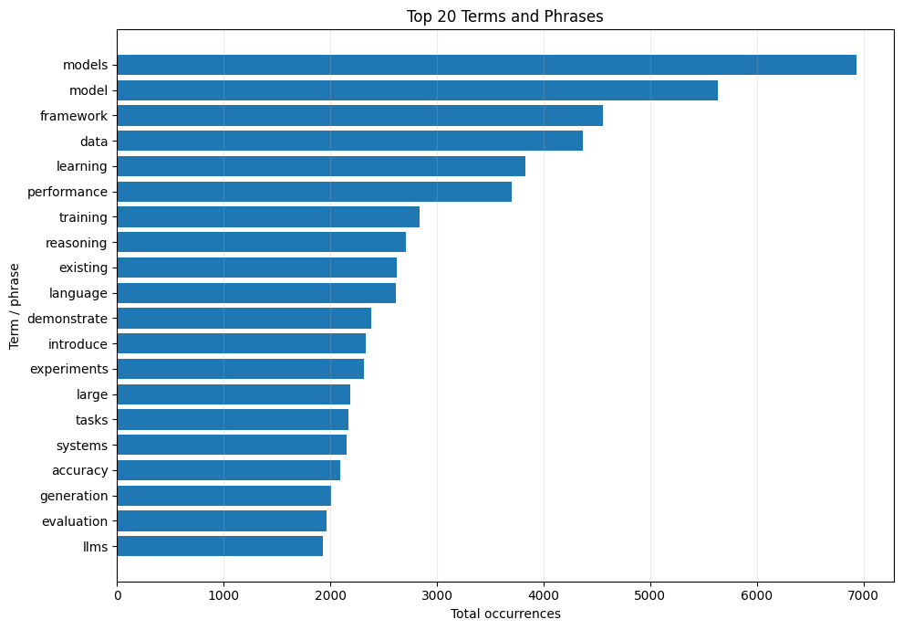
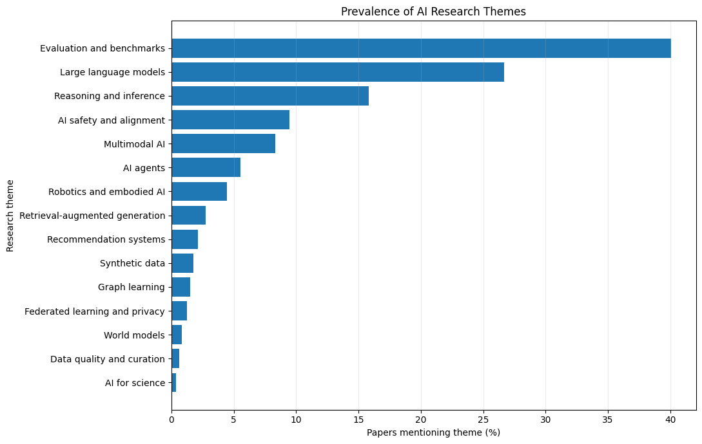
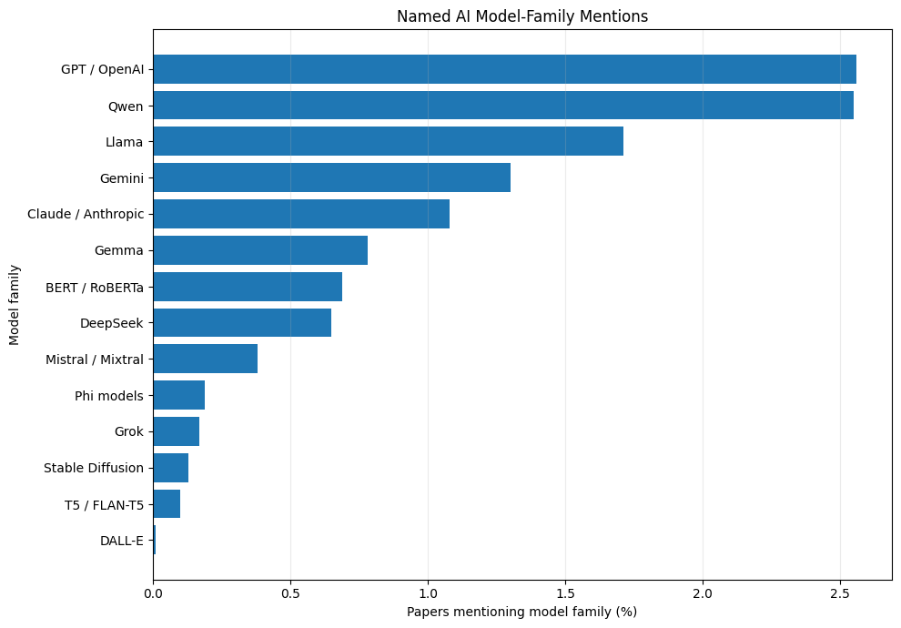
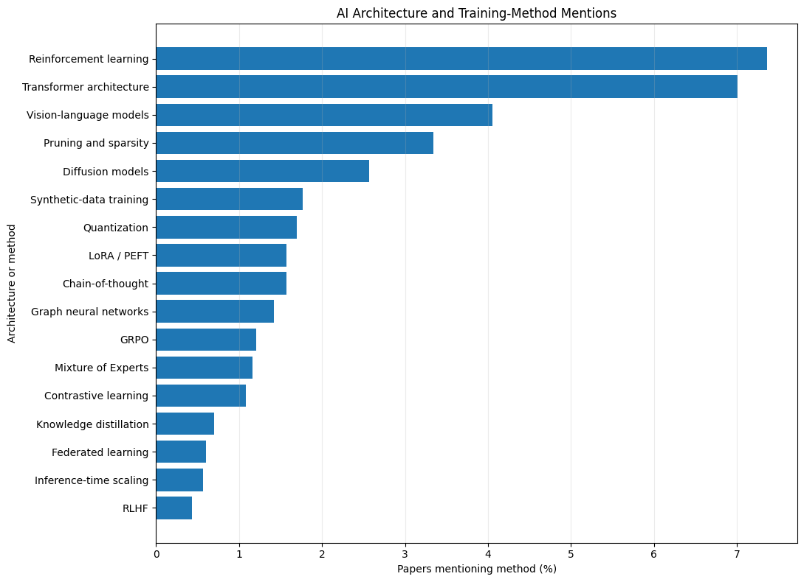
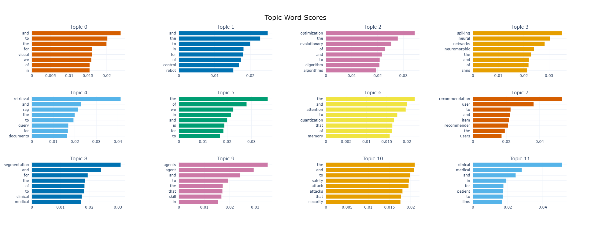
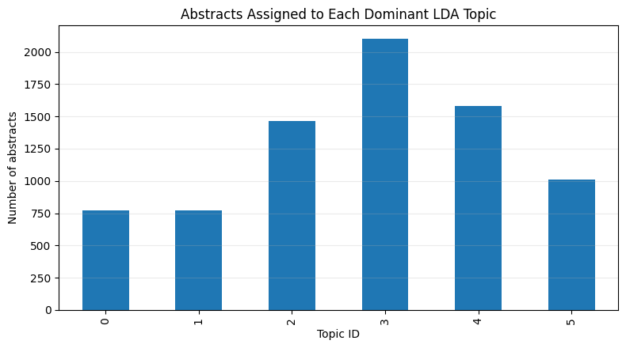
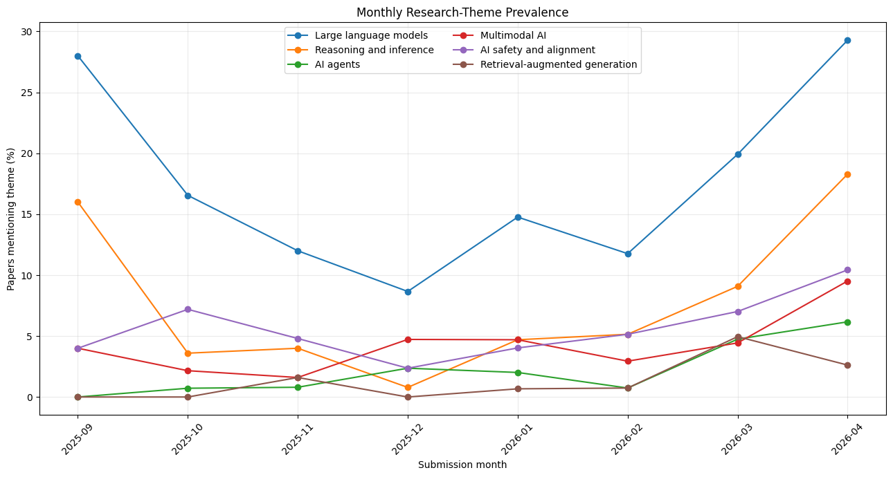

# arXiv AI/ML Research Abstracts: NLP Analysis

Text analysis of **7,701 arXiv AI/ML abstracts** (27 Sep 2025 – 29 Apr 2026) with scikit-learn, sentence-transformers and BERTopic: term and TF-IDF analysis, LDA, sentence embeddings, BERTopic, and keyword-based theme, model-family and method prevalence, with explicit checks on how uneven the collection is over time.

**Notebook:** [`notebooks/arxiv_ai_ml_advanced_nlp_research_notebook_cleaned.ipynb`](notebooks/arxiv_ai_ml_advanced_nlp_research_notebook_cleaned.ipynb) (executed, outputs saved)

## Key results

- **Evaluation and LLM work dominate this sample.** 40.1% of abstracts mention evaluation or benchmarks, 26.7% large language models and 15.8% reasoning. Reinforcement learning (7.4%) and transformers (7.0%) are the most-mentioned methods.
- **Named models:** GPT/OpenAI (2.6%) and Qwen (2.6%) are the most-mentioned families, followed by Llama (1.7%), Gemini (1.3%) and Claude (1.1%).
- **BERTopic finds 30+ coherent niches** beyond the broad LLM / vision themes, for example spiking neural networks, retrieval/RAG, recommendation, medical segmentation, agents, security, forecasting, bandits, protein/molecular, multilingual, federated privacy, EEG, speech and quantum. 34.5% of papers are outliers.
- **The collection is very uneven in time** (78% of records are from April 2026), so none of the monthly patterns below should be read as research growth.

## Dataset

| | |
|---|---|
| Source | [arXiv AI/ML Research Papers 2025-2026](https://www.kaggle.com/datasets/shree0910/arxiv-aiml-research-papers-20252026) on Kaggle (`arxiv_ai_ml_papers.csv`) |
| Size | 7,701 rows × 26 columns; no duplicates, no missing abstracts |
| Period | 27 Sep 2025 – 29 Apr 2026 |
| Largest primary categories | cs.CV 18.4%, cs.LG 18.1%, cs.CL 14.5%, cs.RO 8.2%, cs.AI 7.2% |
| Abstract length | mean 180.8, median 180 words (whitespace tokens of the cleaned text) |

The CSV is not redistributed here; download it from Kaggle (see [Reproduce](#reproduce)). Category counts are quoted from the notebook's dataset-facts section.

### Coverage by month

| Month | Papers | Share of dataset |
|---|---:|---:|
| 2025-09 | 25 | 0.3% |
| 2025-10 | 139 | 1.8% |
| 2025-11 | 125 | 1.6% |
| 2025-12 | 127 | 1.7% |
| 2026-01 | 149 | 1.9% |
| 2026-02 | 136 | 1.8% |
| 2026-03 | 969 | 12.6% |
| 2026-04 | 6,031 | 78.3% |



## Method

1. Load and audit the data; clean abstracts and compute length statistics
2. Unigram and bigram frequencies (`CountVectorizer`) and TF-IDF with extra domain stop words
3. LDA topic model (6 topics, `random_state=42`)
4. TF-IDF cosine-similarity search
5. Sentence embeddings (`all-MiniLM-L6-v2`, 7,701 × 384) with semantic search and k-means (k = 10)
6. BERTopic (`min_topic_size=30`) on title + abstract embeddings
7. Regex prevalence of research themes, named model families and methods
8. Monthly dataset coverage and monthly theme shares

## Results

### Frequent terms

`models` (6,939), `model` (5,634), `framework` (4,559), `data` (4,365), `learning` (3,831), `performance` (3,701), `training` (2,839), `reasoning` (2,708).



### Research themes, model families and methods

Share of papers whose title or abstract matches a keyword pattern for each item (patterns are in the notebook).



| Model family | Papers | Share |
|---|---:|---:|
| GPT / OpenAI | 197 | 2.56% |
| Qwen | 196 | 2.55% |
| Llama | 132 | 1.71% |
| Gemini | 100 | 1.30% |
| Claude / Anthropic | 83 | 1.08% |
| Gemma | 60 | 0.78% |
| DeepSeek | 50 | 0.65% |

| Method | Papers | Share |
|---|---:|---:|
| Reinforcement learning | 567 | 7.36% |
| Transformer architecture | 540 | 7.01% |
| Vision-language models | 312 | 4.05% |
| Pruning and sparsity | 257 | 3.34% |
| Diffusion models | 198 | 2.57% |
| Quantization | 131 | 1.70% |
| LoRA / PEFT | 121 | 1.57% |

 

### BERTopic

30+ topics, with 2,655 of 7,701 papers (34.5%) left as outliers. Topic sizes and the most informative keywords of the largest labelled topics:

| Topic | Papers | Keywords |
|---:|---:|---|
| 2 | 314 | optimization, evolutionary, algorithm |
| 3 | 310 | spiking, neural networks, neuromorphic |
| 4 | 280 | retrieval, RAG, query, documents |
| 7 | 199 | recommendation, user, item |
| 8 | 190 | segmentation, clinical, medical |
| 9 | 171 | agents, agent, skill |
| 10 | 155 | safety, attack, security |
| 11 | 111 | clinical, medical, patient |
| 12 | 92 | forecasting, time series |
| 14 | 86 | molecular, protein, discovery |
| 15 | 83 | languages, multilingual, translation |
| 18 | 73 | EEG, brain |
| 19 | 65 | speech, ASR |
| 20 | 63 | quantum, classical |

Topics 0 (993 papers), 1 (689), 5 (238) and 25 (59) have labels made of stop words ("and", "the", "to") and cannot be named from keywords alone; the notebook explains why and how to fix it.



### LDA topics (6)

Topic labels are my reading of the top terms, not model output.

| Topic | Papers | Share | Top terms | Reading |
|---:|---:|---:|---|---|
| 0 | 1,835 | 23.8% | models, reasoning, language, LLMs, retrieval | LLMs and reasoning |
| 5 | 1,661 | 21.6% | optimization, learning, problem, algorithm | Optimisation and learning theory |
| 2 | 1,162 | 15.1% | evaluation, systems, AI, human, agents | Evaluation and AI systems |
| 4 | 1,105 | 14.3% | visual, image, video, generation, motion | Vision and generation |
| 1 | 1,020 | 13.2% | data, framework, performance, datasets | Generic ("data, framework, performance") |
| 3 | 918 | 11.9% | neural, networks, training, accuracy | Neural network training |



### Monthly theme shares



For example, the share of abstracts mentioning large language models is 28.0% in Sep 2025 (n = 25), 8.7% in Dec 2025, 19.9% in Mar 2026 and 29.3% in Apr 2026 (n = 6,031). These are shares within very different sample sizes, so the pattern describes the sample, not the field.

## Limitations

- **Uneven coverage.** 78% of records are from April 2026 and September 2025 has 25. Early months are noisy and the April-dominated sample can differ in composition from earlier months. No growth or decline claims are supported.
- **Keyword patterns are crude.** A model name or phrase in an abstract does not mean it was used or evaluated. Some patterns are broad: "Evaluation and benchmarks" matches common words, and the safety pattern includes the bare word "alignment", which also appears in non-safety contexts such as multimodal alignment.
- **LDA is unstable and generic.** Re-running the notebook gave different topic sizes from an earlier run with the same seed (for example 1,835 vs 1,462 papers in the largest LLM-related topic), most likely due to library versions. Generic words ("model", "framework", "data") dominate several topics.
- **BERTopic labels need work.** Stop words are not removed in the topic vectorizer, so several labels are uninformative, and a third of papers are outliers.
- **No validation yet.** The k-means clusters and BERTopic topics were not scored (no coherence or silhouette metric) and were not checked against human labels.
- Results describe this sample only, not arXiv as a whole.

## Reproduce

```bash
git clone https://github.com/Zain62543/Analyze-Research-Paper-Abstracts-Using-Data-Science-and-NLP.git
cd Analyze-Research-Paper-Abstracts-Using-Data-Science-and-NLP
python -m venv .venv && source .venv/bin/activate
pip install -r requirements.txt
# download arxiv_ai_ml_papers.csv from Kaggle into data/ (see data/README.md), then set
# FILE_PATH = "../data/arxiv_ai_ml_papers.csv" in the first code cell of the notebook
jupyter lab notebooks/arxiv_ai_ml_advanced_nlp_research_notebook_cleaned.ipynb
```

The embedding and BERTopic sections download `all-MiniLM-L6-v2` on first run and take several minutes on CPU.

## License and citation

Code and notes are released under the [MIT License](LICENSE). The dataset is a third-party Kaggle dataset and keeps its own licence and terms; check them before redistributing the data. See [`CITATION.cff`](CITATION.cff) to cite this work.

## Author

Zain Ud Din · [LinkedIn](https://www.linkedin.com/in/zain-ud-din) · marwatzain8@gmail.com
